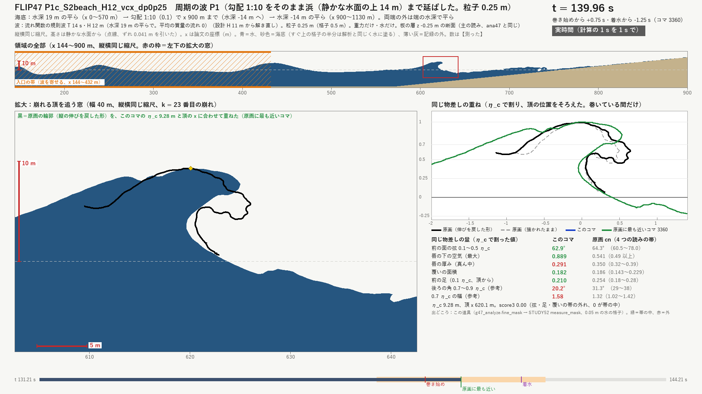

# 成果のまとめ（2026-10-13）：急に浅くなる海底で、重力だけの 2D の巻き波が原画の前の面に近づいた。この海底で 3D に進むかを指導教員に伺っている

- 日付：2026-10-13。書いた者：進行役（Claude）。10/12〜13 の調べと計算の成果を、重みの順に並べた入口の文書。報告を引き継ぐ Codex が最初に読む物（利用者の指示 [Q65](../Workflow/Production_Workflow_ja.md#q65最近の調べと計算の成果を重みを分けて-github-に置きcodex-に報告を任せるという利用者の指示2026-10-13)）。
- 数の出どころ：この文書のために新しい計算はしていない。数は §3 の 5 つの文書から写した。どれも、作っていない別の役が生の記録から測り直し、その直しを入れた値。
- 印：【測定】計算の記録から測った値。【計算】式の値。【文献】出典の内容。【推測】確かめていない読み。
- 原画の物差し（どの文書も同じ）：頂の高さ η_c（静かな水面から頂まで）で割って測る。**前の面の弦**＝前の面の 0.1〜0.5 η_c の間の傾き（原画 64.3°、読みの帯 60.5〜78.0°）。**前の足**＝0.1 η_c の高さの前の面の、頂からの距離（0.254）。**覆いの面積**＝前へかぶさった水の面積（0.186）。**score3**＝この 3 つが原画の帯から外れた分の和で、0 なら 3 つとも帯の中（決まりは走らせる前に凍結）。

## 0. 一枚で

| 流れ | 内容 |
| --- | --- |
| 方針 | 指導教員の「波の形が似ていない」「大波が定期的に現れる状態を」（Q52）、「力は物理的にありえる物なら」（Q54）、「2D の波がまだ不十分では」（Q61）を受けて、形を作る力は足さず、海底の形と来る波だけを選ぶ。重力だけの流体計算（Houdini FLIP）の断面（2D）で原画の形に近づけ、原画と同じ物差しで測り、別の解き手でも確かめる |
| 目標 | (1) 解き手が論文の巻き波を ±5 % で再現する。(2) どの海底で巻く断面が原画に近いかを score3 で比べる。(3) 周期の波で、原画に近い巻きが同じ所に繰り返し出るかを見る |
| 結果 | (1) 崩れの高さ・位置・着水の時刻が論文と 1.4 % 以内【測定】。(2) 勾配 1:10 で浅い所へ上がる海底が最も近く score3 0.29（平らな海底 2.16）。空気と水を両方解く Basilisk でも海底の順は同じ【測定】。(3) 周期 14 s の波が約 14 s ごとに前へ巻き、最も近いコマは前の面 62.9°（原画 64.3°）。ただし一コマだけの値で、約 100 s より後は崩れる所が沖へ動く【測定】 |
| 分かったこと | 平らな海底で波を集めて崩す方法（3D の下見・2D の群の計算・手本の論文の計算）は、前の面が 20〜26° にとどまる部類で、原画の 64° に届かない【測定・文献】。McAllister らの水槽の前へ巻く例も同じ部類【文献】。急に浅くなる海底では、前の面・足・覆い・唇の下の空気がそろって原画の側へ動く【測定】。後ろ側の傾きと唇の厚みは届いていない【測定】 |
| 現在地 | 2D の 4 段（論文の再現・板の直し・海底の比べ・周期の波）と別の解き手の確かめが終わった。利用者が 10/13 に指導教員へ「この似方でよいか、よければこの条件で 3D に進む」を伺い、返事を待っている。返事まで新しい計算は始めない（Q64） |
| 次 | 返事の後：水槽の作りの直し（入口の帯の水が抜ける件）、解析の直し、波の組と波を吸う浜、二つの海底の比べ。認めていただければこの海底で 3D（§4） |

## 1. 重点（重い順）

### 1.1 急に浅くなる海底に周期の波を当てると、原画の物差しで近い巻きの断面が出た（2D）



- 条件：水深 19 m から勾配 1:10 で浜まで上がる海底。周期 14 s の規則波（入れた波高 12 m、入口の帯の先で 10.4〜11.1 m）。重力だけ・水だけ・粒子 0.25 m・190 s。
- 最も近いコマ（8 番目の波、t 139.96 s）：前の面 62.9°（原画 64.3°）、足 0.21（0.254）、覆い 0.182（0.186）、唇の下の空気 0.89（0.49 以上）、唇の厚み 0.29（0.35）、後ろ側 20.2°（31.3°）、score3 0.00【測定】。
- 但し書き：一コマだけの最小で、前後 0.25 s のコマでは score3 1.78 と 0.35。この時刻は水の体積の直し（数の誤差で増減した水を戻す計算の手段。力ではない）が上限に当たっていた【測定】。**手堅い基準は 2 番目の波**（t 58.88 s）：前の面 68.0°、足 0.34、覆い 0.178、唇 0.27、後ろ側 16.9°、score3 0.23。3 本の計算で崩れる位置が 651.2〜651.8 m とそろい、体積の直しも小さい【測定】。
- 詳しく：[2D の海底の実験](FLIP47_2D_Seabed_ja.md) §5〜§7。図 [8 番目の波](../Evidence/FLIP47/P1c_k8_best_f3360.png)・[2 番目の波](../Evidence/FLIP47/P1c_k2_best_f1414.png)。動画 [8 番目の波の全体（120〜150 s）](../Evidence/FLIP47/P1c_k8_whole.mp4)。

### 1.2 解き手は論文を再現し、別の解き手でも海底の順は同じだった

- 論文（Feddersen ら 2024）の巻き波を実物の大きさ（水深 19 m）で解き、崩れの高さ Hb/h0 0.649（論文 0.64）、崩れる位置 41.93 h0（42.05）、着水の時刻 +0.5 %【測定・文献】。巻きの中の空気は論文の 68 % で足りない【測定】。
- 海底 6 種の孤立波（FLIP）：1:10 で浅い平らへ 0.29 ＜ 1:7 の岩棚 0.90 ＜ 論文の海底 1.47 ＜ 平らな海底 2.16（score3。後ろの 2 つは直す前の APIC の受け渡しの値）【測定】。
- Basilisk（利用者が頼んだ雲の計算）でも 0.22 ＜ 0.61 ＜ 1.42 と同じ順。20 通りの探しでは、1:12 から水深 0.15 h0 の棚へ上がる海底（C04）が 1:10 と同じくらい近い【測定】。言えるのは順まで：score3 は格子と置き方で 0.05〜0.6 動き、着水のコマで比べると順は逆になる【測定】。
- 詳しく：[2D の海底の実験](FLIP47_2D_Seabed_ja.md) §2〜§4・§8、[Basilisk での確かめ](../Research/Basilisk_Check_ja.md)、動画 [compare_B.mp4](../Evidence/Basilisk/compare_B.mp4)。

### 1.3 平らな海底で波を集める方法では、原画の前の面に届かない（差の診断）

- 前の面の弦：3D の下見 V1 19.6°、手本の論文の計算そのもの（Fochesato ら 2007 の境界要素法）25.8°（論文の 9 例で 11.8〜25.5°）、2D の Rapp & Melville の群 22.5〜24.3°、原画 64.3°【測定・文献】。差の大部分は論文と原画の間にあり、私たちの数値の粗さの分は量ごとに 1〜32 %【計算】。
- 原画の壁・唇の下の高い空洞・大きな覆いは、文献では急に浅くなる海底の上で水深に限られて巻く波の性格【文献】。原画の覆いの面積を当てはめの式（Pick & Feddersen 2026）に入れると、勾配 1:14〜1:23 の斜面に当たる【計算】。
- McAllister ら 2019 で「北斎に似た」と紹介された写真は 120° の交わりで、上への噴き上がり。前へ巻いた 0° も平らな海底の同じ部類で、入口を決める数が本文から取れず再現できない【文献】。
- 詳しく：[差の診断](../Research/Gap_Diagnosis_20261012_ja.md) §2・§4・§7、重ね図 [shape_overlay.png](../Evidence/FLIP45Diag/shape_overlay.png)。

### 1.4 周期の波で、大波が同じ所に繰り返し出た。ただし約 100 s より後は沖へ動く

- 前へ巻く崩れが 13.92 ± 0.17 s ごとに出て、始めの 4 回（57〜100 s）は x 648〜656 m（標準偏差 3.0 m、水深 10.4〜11.2 m）でそろった（浅い平らを残した計算。浜まで延ばした計算でも 2〜4 番目は x 642〜652 m）【測定】。
- 約 100 s より後は、崩れる所が約 40 m 沖（水深 15〜16 m）へ移った。入口の帯の水面が 2.7 m 下がったこと（体積の直しが帯の水も抜く）と、閉じた水槽の長い揺れが元と読む。海の物理ではなく水槽の作りの影響という読み【測定・推測】。
- 勾配 1:7 の浜では来る波が回ごとにばらつき、崩れる所が散った【測定】。
- 詳しく：[2D の海底の実験](FLIP47_2D_Seabed_ja.md) §5.4・§6、動画 [全部を 4 倍の速さで](../Evidence/FLIP47/P1c_S2beach_H12_vcx_dp0p25_all_x4.mp4)。

### 1.5 残っている差と、確かでない事

| 何が | 今の値 | 原画 | 但し書き |
| --- | --- | --- | --- |
| 後ろ側の傾き（0.7〜0.9 η_c） | きれいに巻いた回で 5.8〜20.2°、中央値 16〜17°【測定】 | 31.3° | 孤立波では 3〜14°、Basilisk でも 14.3° 以下 |
| 唇の厚み | 良い 2 回で 0.27〜0.29。測る回の中央値は 0.10（約 0.9 m、格子 2 個）【測定】 | 0.35（0.32〜0.39） | 唇と空洞は細かさで落ち着いていない（粒子 0.5 → 0.25 m で空洞 +37 %）【測定】 |
| 細かい格子（粒子 0.125 m） | 走らせていない | — | 利用者の判断（Q64）で、海底と波が決まってから 1 本 |
| 体積の直し | コマの 47 % で上限に当たった【測定】 | — | 入口の帯の水も抜く。次の回で直す |
| 解析 | 頂の細い水の柱、取りこぼした崩れ【測定】 | — | 確かめの役が見つけた。次の回で直す |
| 高さ | 入口で波高 11〜12 m を与えている | 10〜12 m（Cartwright & Nakamura の読み）【文献】 | 計算が決めたのは浅くなる間の伸び・崩れる所・崩れ方。高さを物理で生んだとは言えない |
| 2D と 3D | 2D の断面だけ | — | この海底の 3D は計算していない |

### 1.6 3D：下見は 1 本、尾根の場面は用意だけ

- 3D の粗い下見 V1（Fochesato ら 2007 の再現、粒子 0.5 m、1.8 時間）：頂の横の長さ 66.5 m は論文の 66.0 m と +0.8 %。頂 6.19 m・波高 9.45 m は論文より −13 %・−12 %（多くは粗さによる減りと読む【推測】）。唇は届く距離 1.7 m・厚み 0.9 m の小さな巻きで、前の面は約 20°【測定】。
- 尾根の上の孤立波（Guyenne & Grilli 2006）：場面・厳密な孤立波の解き手・解析の道具を作り、短い試しで初めの波を確かめた。本番は走らせていない【測定】。
- 3D では速度の受け渡しを FLIP にする（APIC が対称の面へ偽の横流れを作り、頂を遅らせるため）【測定】。
- 詳しく：[3D の粗い下見](FLIP45_3D_Preview_ja.md)（動画 [V1_3view.mp4](../Evidence/FLIP45/V1_3view.mp4)）、[3D の尾根の用意](FLIP46_3D_Ridge_Setup_ja.md)。

## 2. 経緯（指示の順）

原文の引用と扱いは [制作手順](../Workflow/Production_Workflow_ja.md) の各 Q。

| 日 | Q | 誰 | 中身 → したこと |
| --- | --- | --- | --- |
| 10/11 | [Q52](../Workflow/Production_Workflow_ja.md#q52波の形が似ていないこと大波が定期的に現れる状態を作る方法を検討することという指導教員の答え2026-10-11-2019)・[Q54](../Workflow/Production_Workflow_ja.md#q54力は超常的なものは認めず物理的にありえるものなら考慮の余地があるという指導教員の補足2026-10-11) | 指導教員 | 波の形が似ていない、大波が定期的に現れる状態を検討する。力は物理的にありえる物なら考慮の余地がある |
| 10/12 | [Q59](../Workflow/Production_Workflow_ja.md#q593d-の粗い下見を先に走らせるという利用者の指示2026-10-12) | 利用者 | 3D の粗い下見を先に → V1 |
| 10/12 | [Q60](../Workflow/Production_Workflow_ja.md#q60選んだ案そのものを問い直しmcallister-らの水槽実験とほかの大波の作り方を尋ね海底の類を粗く試すという利用者の問いと判断2026-10-12) | 利用者 | 原画との差の原因、McAllister らの実験、ほかの作り方を問う → 差の診断、海底が浅くなる類の 3D の用意 |
| 10/12 | [Q61](../Workflow/Production_Workflow_ja.md#q612d-の波がまだ不十分ではないかという指導教員の答えと2d-を先にするという利用者の判断2026-10-12) | 指導教員・利用者 | 「2Dの波がまだ不十分ではないですか？」→ 2D を先に（論文の再現、海底 6 種） |
| 10/13 | [Q62](../Workflow/Production_Workflow_ja.md#q62周期の波の実験を続け実験が終わるごとに動画で確かめさせるという利用者の指示2026-10-13) | 利用者 | 周期の波を続け、実験ごとに動画で確かめる → 周期の波、板の層の直し、確かめの役の指摘 |
| 10/13 | [Q63](../Workflow/Production_Workflow_ja.md#q63東京湾の地理の位置は考えず物理だけで波を最も似せるという利用者の判断2026-10-13) | 利用者 | 東京湾の地理は考えず、物理だけで最も似せる |
| 10/13 | [Q64](../Workflow/Production_Workflow_ja.md#q64細かい格子の確かめを飛ばし今の計算が終わったら指導教員の返事を待って次を決めるという利用者の判断2026-10-13) | 利用者 | 細かい格子の確かめは飛ばし、返事を待って次を決める。指導教員への文は短く、一つの問いで |
| 10/13 | [Q65](../Workflow/Production_Workflow_ja.md#q65最近の調べと計算の成果を重みを分けて-github-に置きcodex-に報告を任せるという利用者の指示2026-10-13) | 利用者 | 成果を重みを分けて GitHub に置き、報告を Codex に任せる。雲の計算の枝を作業の枝へ合わせる |

## 3. ファイルの地図

| 種類 | 場所 | 中身 |
| --- | --- | --- |
| 結果（主） | [FLIP47_2D_Seabed_ja.md](FLIP47_2D_Seabed_ja.md) | 2D の海底の実験：論文の再現、板の直し、海底 6 種、周期の波、確かめの役の直し、最も近いコマ |
| 調べ | [Gap_Diagnosis_20261012_ja.md](../Research/Gap_Diagnosis_20261012_ja.md) | V1 と原画の差の診断（形・細かさ・物理の条件・見え方）、McAllister らへの答え |
| 確かめ | [Basilisk_Check_ja.md](../Research/Basilisk_Check_ja.md) | 別の解き手 Basilisk（雲の計算） |
| 結果（3D） | [FLIP45_3D_Preview_ja.md](FLIP45_3D_Preview_ja.md) | 3D の粗い下見 V1 |
| 用意（3D） | [FLIP46_3D_Ridge_Setup_ja.md](FLIP46_3D_Ridge_Setup_ja.md) | 3D の尾根の孤立波（走らせていない） |
| 前回の報告 | [Supervisor_Report_20261012_ja.md](Supervisor_Report_20261012_ja.md) | 10/12 に指導教員へ送った報告（形と言い方の手本） |
| 前からの調べ | [作り方](../Research/BigWave_Recipes_ja.md)・[高い波の仕組み](../Research/TallWave_Mechanisms_ja.md)・[先行作品](../Research/PriorWorks_GreatWave_ja.md)・[交わる波](../Research/CrossingWaves_Survey_ja.md)・[力と崩れの形](../Research/PhysicalForces_BreakingShape_ja.md)・[定期的な大波](../Research/PeriodicBigWave_Study_ja.md) | 出典の一覧と読み |
| 証拠 | [Evidence/FLIP47](../Evidence/FLIP47/)・[Evidence/FLIP45](../Evidence/FLIP45/)（どちらも README_ja.md に図と動画の読み方）・[Evidence/FLIP45Diag](../Evidence/FLIP45Diag/)・[Evidence/Basilisk](../Evidence/Basilisk/) | 図・動画・数の表 |
| 道具 | [flip45](../../Tools/GWWaveGen/flip45/)・[flip46](../../Tools/GWWaveGen/flip46/)・[flip47](../../Tools/GWWaveGen/flip47/)・[ruler](../../Tools/GWWaveGen/ruler/)（原画の物差し）・[Tools/Basilisk](../../Tools/Basilisk/) | 場面を作る・走らせる・読む・動画 |
| 場面 | [Houdini/FLIP45](../../Houdini/FLIP45/)・[FLIP46](../../Houdini/FLIP46/)・[FLIP47](../../Houdini/FLIP47/) | Houdini Indie の .hiplc |
| 指示の記録 | [制作手順](../Workflow/Production_Workflow_ja.md) Q52〜Q65 | 利用者と指導教員の原文 |

- 枝：`claude/art-first` が作業の枝で、`main` は毎回同じコミットへ早送りする（Q14）。`cloud/basilisk-input` は雲の計算に渡した原画の物差し。`cloud/basilisk-check` は雲の計算の結果で、Q65 の「合并」により `claude/art-first` へ合わせる。PR は次の 1 つ。

  https://github.com/imagirelab/GreatWave_2026/pull/1

- 名札 `art-sample06`：見本06 の戻り先。作品の主役波・材質・場面は 10/12〜13 に変えていない。
- 本機の記録（Git の外）：`Unity/Build/FLIP45/`〜`FLIP47/`（計算の書き出し、全部の動画、役ごとの記録）。文書では名前だけ書く。

## 4. 未決と次

未決の事と、決まる時：

1. この似方でよいか、よければこの海底で 3D に進むか：指導教員の返事で決まる（利用者が 10/13 に Discord で伺った）。
2. 3D に使う海底（1:10 で浅い所へ、または 1:12 で水深 0.15 h0 の棚へ）：返事の後、次の回の比べで決める。
3. 細かい格子（粒子 0.125 m）：海底と波が決まった後に 1 本（Q64）。
4. 10/12 より前からの待ち（リアルタイムの再生の試作への問い、Q46 の確かめ）：[README](../../README.md) の「待っていること」。

次の回の案（返事の後。力は足さず、境界の条件と解析の直しだけ）：

1. 入口の帯の水が抜ける件：体積の直しを帯の外だけに置くか、帯の平均の水面を保つ。
2. 解析：頂の細い水の柱をならして除く、崩れの取りこぼしを直す、最も近いコマに前後のコマの値を並べる。
3. 波の組（数本の波と静かな間）と、波を吸う浜。
4. 二つの海底を FLIP で比べ、3D に使う物を一つに決める。
5. 粒子 0.125 m で 1 本確かめる。
6. 認めていただければ 3D（尾根の場面か下見の場面にこの海底を入れ、受け渡しは FLIP）。

期限は 2026-10-29（AGENTS.md）。

## 5. Codex への引き継ぎ（報告の作り方）

### 5.1 誰が誰に

- 指導教員（今給黎先生）：GitHub の `main` と Discord を読み、方針を決める。
- 利用者：Discord で指導教員に送り、方針を決める。指導教員は利用者自身が資料をまとめることも求めている（[Q58](../Workflow/Production_Workflow_ja.md#q58claude-に考えさせると同時に自分でも資料をまとめることを進めるようにという指導教員の答え2026-10-12)）ので、Codex の下書きは利用者が読み、自分の言葉で確かめてから送る。
- Codex（GPT-6）：Q65 で報告の作業を任された。Discord の文・文書・スライドの下書きを作る。指導教員へ直接は送らない。計算・道具・場面・規則のファイルを変えるかは Q65 に含まれないので、利用者に確かめる。
- 計算と文書は進行役（Claude）、Basilisk は利用者が頼んだ Claude の雲の会話。誰がしたかを書き分ける（AGENTS.md の「担当」）。

### 5.2 決まり

1. 指導教員への Discord の文は 2〜3 文で、利用者が知りたい一つの問いを中心にする（Q64）。中身は、結果の数 1 つと原画の値、問い、認められた時に何をするか。背景・方法・但し書きの列は書かず、画像と動画を付ける。
2. 文書とスライドは 方針 → 目標 → 結果 → 分かったこと → 現在地 → 次 の順（目標を結果より先に）。
3. 数には理由と印（測定・計算・文献・推測）を付ける。印象から言い切らない（Q39「強い主張の言葉を一切使うな」）。AI が自分で確かめただけの事は、そう書く。
4. 未決の事は未決と書き、決まる時（日付か出来事）を添える。
5. 指導教員への文では内部の名前（P1c、S2、C04、k8、FLIP47、score3 など）を使わず、中身で言う（Q40：情報のない名前で話さない）。リポジトリの文書の中では使ってよい。
6. 指導教員に向けた文で使わない言葉：多分、一定、さらに、誇張、インパクト、完成、成功、合格、自由、失敗、面白い、すごい、一応、とりあえず。
7. 制作手順の Q56 の扱い 1 で「指導教員への文で触れない」と決めた物には、どの文でも触れない。
8. 場面の場所（東京湾・神奈川沖）で実際に起こりうるかは論じない（Q63）。
9. URL は 1 行に 1 つだけ置く。
10. ゼミの資料は、ゼミの半日前までに指導教員へ出す（Q40。記録の上の次は 10/14 の共通ゼミ。今も予定どおりかは利用者に確かめる）。

### 5.3 言ってよい事・但し書きが要る事・言わない事

| 言ってよい事 | 根拠 |
| --- | --- |
| 重力だけの計算で、論文の巻き波の高さ・崩れる位置・着水の時刻を 1.4 % 以内で再現した | [FLIP47](FLIP47_2D_Seabed_ja.md) §2【測定】 |
| 海底を急に浅くすると、前の面・足・覆い・唇の下の空気が原画の側へ動く。海底の順は別の解き手でも同じ | FLIP47 §4・§8【測定】 |
| 平らな海底で波を集める方法は、手本の論文の計算そのものが前の面 約 26° で、原画の 64° に届かない部類 | [差の診断](../Research/Gap_Diagnosis_20261012_ja.md) §2・§4【測定・文献】 |
| 周期 14 s の波で、前へ巻く崩れが約 14 s ごとに出た。始めの 4 回は同じ所 | FLIP47 §5.4【測定】 |
| 3D の下見で、頂の横の長さが論文と合った（66.5 m と 66.0 m） | [FLIP45](FLIP45_3D_Preview_ja.md) §2.2【測定】 |

| 但し書きを付けて言う事 | 付ける但し書き |
| --- | --- |
| 原画に最も近い瞬間は前の面 63°（原画 64°） | 一コマだけの値。手堅い基準は 2 番目の波の 68°（score3 0.23）。後ろ側（20° と 31°）と唇の厚みは届かない |
| 同じ所に繰り返し出る | 約 100 s まで。その後は約 40 m 沖へ動く（水槽の作りの影響と読む【推測】） |
| Basilisk でも同じ結果 | 同じなのは海底の順。score3 の小数第 2 位は意味を持たない。着水のコマで比べると順は逆 |
| 細かくしても大きな形はほとんど変わらない | 平らな海底の 2D と論文の再現の範囲の話。唇と空洞は落ち着いていない（+37 %）。粒子 0.125 m は走らせていない |
| 原画の形は、急な海底で水深に限られて巻く波の性格 | 文献と 2D の計算からの読み。3D では計算していない |

| 言わない事 | 理由 |
| --- | --- |
| 「原画に似た巻きが約 14 秒ごとに出る」 | 原画に近いのは一部の回の一瞬だけ（Q64 の扱い 2） |
| 「原画の帯に全部入った」「score3 が 0 になった」（但し書きなし） | 一コマだけの最小 |
| 「高さを物理で作った」 | 高さの大半は入口で与えた（FLIP47 §9 の 6） |
| 「勾配 1/100 から 1/10 で空洞が約 10 倍」 | 1:10 は当てはめの式の範囲の外（差の診断 §6 の 4）。制作手順の Q60 の扱い 1 にこの言い方が残っている。言うなら「式の範囲の中で、原画の覆いは勾配 1:14〜1:23 に当たる」 |
| この海底の 3D の結果 | まだない |

### 5.4 Discord の下書き（3 行）

利用者は 10/13 に同じ問いを伺っている。送り直すか、返事の後の文に使うかは利用者が決める。

```
重力だけの 2D の計算で、海底を急に浅くした所へ周期 14 秒の波を送り続けると、前へ巻く大波が約 14 秒ごとに出ました。
原画に最も近い瞬間は前の面の傾きが 63°（原画 64°）で、波の後ろ側は 20°（原画 31°）とまだなだらかです。
この似方で、この海底の条件のまま 3D に進んでよろしいでしょうか。
```

- 付ける物（どれも 10 MB 未満）：画像 [P1c_k8_best_f3360.png](../Evidence/FLIP47/P1c_k8_best_f3360.png)（0.22 MB、最も近い瞬間と原画の輪郭の重ね）、動画 [P1c_k8_whole.mp4](../Evidence/FLIP47/P1c_k8_whole.mp4)（3.86 MB・42 s、崩れの前後をスローで見せ、最も近いコマで止める）。繰り返しを見せるなら [P1c_S2beach_H12_vcx_dp0p25_all_x4.mp4](../Evidence/FLIP47/P1c_S2beach_H12_vcx_dp0p25_all_x4.mp4)（6.53 MB・47.5 s、190 s を 4 倍の速さで）。画像の見出しには内部の名前が入っている。
- 利用者の手元にも同じ画像と動画の写しがある（`G:\research\Wave Simulation\_report_20261013\`、Git の外、ファイル名は中国語）。
- 詳しく見ていただく時に添える URL（1 行で）：

  https://github.com/imagirelab/GreatWave_2026/blob/main/Docs/Progress/Results_Summary_20261013_ja.md

- 聞かれたら答える事：一コマだけの値であること（2 番目の波の 68° が手堅い基準）、約 100 s より後に崩れる所が沖へ動くこと、高さは入口で与えていること、唇がまだ薄いこと（§5.3 の但し書き）。
- 返事が来たら、原文のまま [制作手順](../Workflow/Production_Workflow_ja.md) に次の Q として記録してから次へ進む。

### 5.5 読む順

1. この文書。
2. [2D の海底の実験](FLIP47_2D_Seabed_ja.md) の §0・§0.1・§7（確かな事・確かでない事と、最も近いコマ）。
3. [差の診断](../Research/Gap_Diagnosis_20261012_ja.md) の §0・§4・§7。
4. [Basilisk での確かめ](../Research/Basilisk_Check_ja.md) の「一枚で」と §4。
5. [3D の粗い下見](FLIP45_3D_Preview_ja.md) と [3D の尾根の用意](FLIP46_3D_Ridge_Setup_ja.md) の §0。
6. [制作手順](../Workflow/Production_Workflow_ja.md) の Q39・Q40（指導教員の伝え方の指摘）と Q52〜Q65。
7. [前回の報告（10/12）](Supervisor_Report_20261012_ja.md)：すでに伝えた事と、報告の形。
