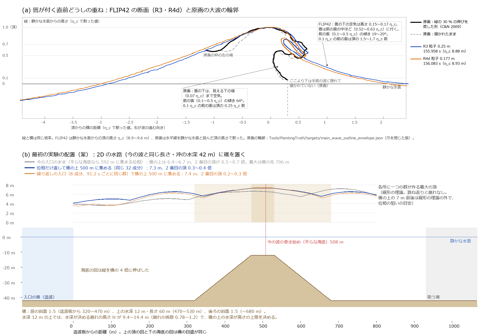

# 波の形の違いと、大波が決まった間隔で現れる状態の作り方（10/11 のお答えへの検討と提案）

- 日付：2026-10-11。書いた者：進行役（Claude）。先生の 10/11 20:19 のお答え（Discord）への検討で、学生（王）を通して先生にお送りし、お返事を待つ。記録は[制作手順](../Workflow/Production_Workflow_ja.md)の Q52。
- この段は検討だけ：今の波の記録を読んで測り、線形の理論で軽く計算し、文献を読んだ。流体の計算と Houdini は使っていない。
- 作業メモはリポジトリの外（この機械の `Unity/Build/STUDY52/`）にあり、リンクは開かない。§1・§2 の数は、作っていない別の者の確かめで直した後の値（確かめの報告は途中で切れて渡り、切れた先は入っていない）。§3 の数（礁の形と位置、入口の位相の狙い、費用、日程）は新しく出した物で、別の者の確かめは受けていない。
- 印：【測った】記録・輪郭から読んだ値。【計算】式の値。【文献】出典の内容（確かさを書く）。【考え】【推定】進行役の推論と見積もりで、確かめていない。
- 記号：η_c は静かな水面から頂までの高さ、H は頂から谷まで。形の長さと高さは η_c で割った値で書く（例「0.25 η_c」）。「今の波」は 10/12 の報告の巻き波の計算（2D の断面、重力だけ。作業名 FLIP42。R3 は粒子 0.25 m、R4d は 0.177 m の 2 本）。

## 一枚で

| 流れ | 内容 |
| --- | --- |
| 方針 | お答えの 2 点を検討した。(1) 形：今の波と原画の大波を同じ量で測って違いを書き、違いを原画の側へ動かす物理の条件を文献で探した。(2) 繰り返し：大波が決まった間隔で現れる仕組みを 8 つ比べた。点ごとに合わせる目標にはしない |
| 目標 | (1)(2) を一つの計算の条件で試せる最初の実験を決める |
| 結果 | (1) 違いは唇の下にある。前の面の傾き 原画 64°／今の波 19〜20°、唇の下の空気の高さ 0.54 η_c 以上／0.15〜0.17 η_c、唇の厚み 0.24〜0.35 η_c／0.11〜0.12 η_c。今の波は 2D の計算なので、頂が横にどこまでも同じ長い堤（原画は横に短い頂）。頂から唇の先までの外の線は、頂の高さと位置をそろえると近い【測った】 (2) 比べた 8 つの中で、間隔が決まるのは入ってくる波に周期がある時だった。不規則な海では、大波の来る時はばらばら（間隔の標準偏差 ÷ 平均 0.84〜1.06）【計算・考え】 |
| 分かったこと | 1. 決まった間隔は、どの仕組みでも沖から入る波（計算では入口）が持ち込む。計算の中の物理が決めるのは、崩れる所・崩れ方・集まりで上がる分の高さ【考え】 2. 唇の下を原画の側へ動かす向きは文献に 3 つ：急に浅くなる海底（礁）の上で巻く（要旨だけで数はない）、群を強くする（今の波に当てても原画の値の半分に届かない見込み）、向きの集まり（3D。前の面がほぼ鉛直の壁になってから巻く実験）【文献・推定】 3. 唇の厚みは、論文の数に原画に届く例がない【文献・測った】 |
| 現在地 | 検討だけで、流体の計算はしていない。期限 10/29 まで 18 日。残りは大波の計算と、その Unity での再生 |
| 次（案） | 礁に、入口から 91 s ごとに同じ群を送る（間隔と高さの大きさは入口で選ぶ仮定）。まず 2D：形は今の波と同じ 32 成分の入口に礁を足して比べ（位相を礁の上へ合わせ直すかは下見で決める）、繰り返しは 91 s で厳密に戻る 8 成分の入口で見る。10/14 にお返事なら 10/19 に結果【推定】。海底を置かない代わり：3D の区画で向きと周期を 70 s ごとに集める 10/29 に見せられる見込みは、礁なら 2D の断面の繰り返しの再生、海底なしなら粗い 3D の繰り返し。どちらでも、3D で原画の性格の形に届くとは示せていない【推定】 |
| 伺うこと | 1. 礁を置いてよいか（神奈川沖の水深には見えない仮定） 2. 「定期的」は、小さい波の間に 1〜2 分ごとに大波が来る形か、どの波も大きい形か 3. 入口が同じ群を決まった間隔で送ることを「状態」と認めていただけるか 10/13 18:00 までに Discord で、なければ 10/14 のゼミで伺う |

図【測った・計算】：(a) 唇が付く直前どうしを、頂の高さ η_c をそろえ、縦と横を同じ倍率で重ねた。黒が原画（縦の約 30 % の伸びを戻した形）、灰の破線が描かれたまま、青が今の波の R3、橙が R4d。原画の前の面は 0.07 η_c より下が手前の波に隠れて描かれていない。(b) 最初の実験の配置の案。上は、一つの群が各所に作る最大の頂（線形の理論、跳ね返りと崩れなし）。灰は今の入口のまま、青は位相だけを礁の上 500 m に集まるように直した入口、橙は 91 s ごとに戻る入口。下は海底（縦は横の 4 倍）。

## 1. 形の違い

### 1.1 測り方

- 量は測る前に決め、その理由を書いた（作業メモ `shape_ja.md` §2）。唇の下の空気の高さだけは、最初の重ね図を見た後に足した。両方を同じ作り方の水の格子（水かどうかの 2 値）にして読んだ。
- 原画：大波の輪郭 `Tools/PaintingTruth/targets/main_wave_outline_envelope.json`（爪の指を閉じた版）。静かな水面は水平線（画像 3859×2594 の y = 1885 px）と読んだ。Cartwright & Nakamura 2009 は、画面の縦が約 30 % 伸びていると読む【文献：学生の文献整理による】。縦を 1/1.3 にした形を主にし、描かれたまま、静かな水面を ±0.1 η_c 動かした読みを感度の幅にした。横から見た断面と読んだ（斜めから見ている分は直していない）。
- 今の波：R3 と R4d の断面の記録。巻き始め・いちばん巻いた・唇が付いた の 3 コマを測り、比べの主は「いちばん巻いた」（どちらも唇が付く 1 コマ、0.04 s 前）。
- 作っていない別の者が、作り方を変えて（記録の符号付き距離を線で直接切る、原画の輪郭を多角形のまま切る）測り直し、0.01〜0.04 η_c・1° 以内で合った。

### 1.2 量【測った】

| 量 | 原画（縦の伸びを戻した形。括弧は感度の幅） | 今の波（いちばん巻いたコマ、R3／R4d） | 違い |
| --- | --- | --- | --- |
| 唇の下の前の面の傾き（0.1〜0.5 η_c の弦） | 64°（53〜78°） | 19°／20° | 約 3 倍 |
| 0.1 η_c の高さの前の面の位置（頂から前へ） | 0.25 η_c（0.18〜0.35） | 1.66／1.54 η_c | 1/4〜1/9 |
| 唇の下の空気の高さ（最大） | 0.54 η_c 以上（下限。唇の先の下は水平線近くまで空と富士が見え、水平線までなら約 0.61） | 0.15／0.17 η_c | 3 倍以上 |
| 唇の厚み | 0.35 η_c（爪の指の間を空けた輪郭では 0.24） | 0.11／0.12 η_c（1.0／1.1 m） | 約 2〜3 倍 |
| 覆いかぶさった水の面積 | 0.18 η_c²（爪の版 0.135） | 0.05 η_c² | 約 2.8〜4 倍 |
| 覆いの根元（頂から前へ） | 0.05 η_c（頂の真下の壁から覆いが出る） | 0.23／0.19 η_c | 1/4〜1/5 |
| 頂の横の長さ | 横に短い（量にしていない） | 横にどこまでも同じ（2D の計算） | — |
| 唇の届く距離 | 0.59 η_c | 0.43／0.44 η_c | 近い（1.4 倍） |
| 覆いかぶさった高さ | 0.58 η_c | 0.43／0.50 η_c | 近い（1.2〜1.3 倍） |
| 唇の先の高さ | 0.62 η_c | 0.55／0.50 η_c | 近い（1.1〜1.2 倍） |
| 0.7 η_c の高さの幅 | 1.32 η_c | 1.37／1.42 η_c | 近い |
| 頂の後ろ側の傾き（0.7〜0.9 η_c） | 31° | 22°／20° | 近い（1.4〜1.6 倍） |

- 今の波にはほかに、浅く遠い前の谷（−0.12〜−0.14 η_c、頂から約 10 η_c 先）、深い後ろの谷（−0.50〜−0.51 η_c）、静かな水面より上で 43〜44 m の後ろ側の長いゆるい坂がある。原画の谷は手前の波と船に隠れて読めない。
- 静かな水面を ±0.3 η_c、縦の伸びを 1.2〜1.4 倍に動かしても、唇の下の空気（原画 0.42 η_c 以上）・唇の厚み・面積・覆いの根元の違いは残る（確かめ）。
- 頂から唇の先までの外の線の差は、頂の位置と高さをそろえた上で、最大 0.10〜0.11 η_c（確かめ）。そろえ方で近く見える分を含む。
- 原画の唇の厚みと面積は、爪の帯を水に数えた上限と、爪の指の間を空けた値の幅で書いた。

まとめ【考え】：原画は「唇の下まで立った壁に厚い覆いが載り、唇がほぼ波の高さいっぱい落ちる形」。今の波は「後ろ側の長い丘の上の端だけが巻き、薄い唇が自分の前の面の中ほど（0.52〜0.63 η_c）に落ちる形」で、頂は横に長い堤。違いは「巻いた部分の下に何があるか」「唇の太さ」「頂の横の短さ」である。

### 1.3 違いを原画の側へ動かす物理の条件【文献】

| 条件 | 文献の内容 | 動く量と向き | 確かさ |
| --- | --- | --- | --- |
| 急に浅くなる海底（礁・急な斜面）の上で巻く | 野外の lidar：唇の下の空気（管）の面積は、海底が急なほど・崩れる水深が浅いほど大きい。丸さは、海底が急なほど・崩れる水深 ÷ 波長が大きいほど（と向かい風で）大きい（O'Dea ら 2021）。1:10 の潜堤：堤の上が浅いほど崩れが強く、囲む空気が大きい（Blenkinsopp & Chaplin 2008）。水槽：砂州と人工の礁の上では巻き波と崩れ落ちる波が多く、平らな斜面ではこぼれる波（Smith & Kraus 1990） | 唇の下の空気は大きく、前の面は立ち、前の谷は深くなる向き【考え】 | 低（要旨だけ。どの量がどれだけ動くかの数はない） |
| 同じ一方向の群の強さを上げる（今の波の延長） | 水深 0.91 m の水槽の 32 成分の群で、弱から強へ、着水の時の唇の下の面積 +86 %、着水点から頂までの高さ +31 %、横の長さ +42 %。ほかの多くの形の量は 1 割ほど（Erinin ら 2023） | 唇の下の空気は原画の側へ動く。今の波に当てて 0.20〜0.24 η_c ほどで、0.54 以上には遠い【推定】 | 高（本文） |
| 向きの集まり（3D） | 向きの広がりのある群で、前の面がほぼ鉛直の水の壁になってから巻く（McAllister ら 2019、実験）。向きが広いほど横に短い巻き（McAllister ら 2024）。崩れの前に届く頂が約 2 割高い（Johannessen & Swan 2001） | 前の面の立ち方、頂の横の短さ、η_c。唇の下の空気への効きは数がない | 高（実験）。断面の量は未確認 |
| 2 段の段差で崩れが合わさる | 低い段で崩れかけた波に後ろの頂が追いつき、巻きの下の面積がふつうの巻きより 6 割以上大きいことがある（Desmons & Lubin 2022） | 唇の厚み・面積。厚み ÷ 高さの数はない | 高 |
| 向かい風 | 斜面と棚の 2D の直接計算で、噴流の面積は向かい風で +5 %、追い風で −40 %（Feddersen ら 2024） | 唇の厚み（小さい） | 高 |

- 巻く海底の目安【計算】：岸の崩れの分け方で、イリバーレン数 ξ0（勾配 ÷ √(沖の波高 ÷ 沖の波長)）0.5〜3.3 が巻き波（Battjes 1974、教科書の値）。周期 9.5〜14 s・沖の波高 6〜10 m で、ξ0 0.5〜1 になる勾配は 1:4〜1:14。
- 唇の厚み【文献・測った・計算】：論文の値は H で割って 0.04〜0.13、今の波は 0.08〜0.11（前の谷か後ろの谷か）。原画の 0.24〜0.35 η_c を H で割った値に直すと、原画の谷は読めないので今の波の H ÷ η_c（1.11〜1.45）を借りて 0.17〜0.32 H で、論文の値より厚い。一般向けの記事（Shand 2024）はタヒチのテアフポオの唇を波の高さの約半分と書くが、厚みの定義と測り方が書かれていないので、数としては比べない。礁の上でどこまで太るかは最初の実験で測る。

## 2. 大波が決まった間隔で現れる仕組みの比べ

| 仕組み | 間隔 | 現れる所 | 崩れ方 | 高さはどこから | この機械の費用【推定】 | Unity での繰り返し |
| --- | --- | --- | --- | --- | --- | --- |
| 規則のうねり＋礁・尾根・浅瀬 | 毎周期（ばらつき 0） | 礁の決まった所 | 1:5 なら周期 9.5〜14 s で巻く。1:10 は 14 s だけ、1:20 はこぼれる【計算】 | 入ってくるうねり。浅くなる働きは線形で 0.93〜1.13 倍で、沖に 10〜12 m が要る【計算】。浅瀬のレンズで規則波は 2 倍超【文献：要旨】 | 2D 4〜12 時間（20〜44 周期、粒子 0.34375 m）。3D の礁の区画 74〜89 時間（20 周期） | 1 周期（9.5〜12 s） |
| 波のプールの機械 | 機械の番組（Surf Ranch は 3〜4 分ごと） | 設計した海底 | 巻く（H 約 2 m） | 機械の行程 | — | 番組の周期 |
| 二つの周波数の列 | 群の周期。水面が厳密に戻るのは周波数が P の整数分の一の時 | 線形では焦点がない | 群の中の 41 % の波が最大の 8 割を超える【計算】 | 成分の振幅 | 繰り返す群と同じ桁 | 群の周期 |
| 集まる群を入口から繰り返す（今の波の延長） | P（周波数を m_n / P にする。成分 8 で 91 s） | 焦点（決まる） | 今の波と同じ巻き | 入口の振幅と、周期の違う波が集まる分【計算・測った】 | 2D 10〜13 時間（3 回、粒子 0.34375 m）。3D の区画 10〜13 時間（P 70 s、2 回） | P（2D は 1 回分 約 360 MB） |
| 逆向きの流れ（地形を使わない） | 入ってくる波しだい（規則のうねりなら毎周期、繰り返す群なら群ごと） | 流れが速まって波を止める所の手前（流れと水深で決まる） | 止められる所の手前で崩れる（Chawla & Kirby 2002）。場所で変わる逆向きの流れの上では主にこぼれる波だったという報告（EGU 2018 の要旨の検索の要約） | 入ってくる波。流れ 1〜3 m/s で線形 1.1〜1.5 倍【計算：深い水の見積もり】 | 2D は礁と同じ桁の見込み。ただし水を入れて出す境界を新しく作る（10/7〜8 の試作では、圧力が解けない失敗の恐れが大きいとして見送った） | 入ってくる波しだい |
| 不規則な海 | ばらばら（H > 1.5 Hs は平均 14〜19 分ごと、ばらつき 0.84〜1.06。セットも平均 4 分前後でばらつき 0.86〜0.92）【計算】 | ばらばら | 多くはこぼれる | 海の状態（有義波高） | 2D で物理の 1 時間に 92〜110 時間（粒子 0.34375 m）。10/29 までの時間に合わない | 繰り返さない |
| 変調の不安定（一様な列が自分の力で一部に集まる） | 種を入れれば T/ε（ε 0.1 で 95 s） | 入口から 8〜14 km（水深 70・42 m）【計算】 | 崩れると繰り返しが崩れる【文献】 | 物理（一様な列の 2〜3 倍） | km の水路が要り、本機の FLIP では 10/29 までの時間に合わない。別の解き方で運ぶつなぎが要る | T/ε |
| 風の海 | ばらばら | ばらばら | 向かい風で唇が太る向き | 風が育てた海 | 育つのに km と時間が要り、計算の範囲の中では育たない | 繰り返さない |

- 繰り返す入口の作り方の直し（確かめで見つけた誤り）：帯を等分した成分の和は、包絡だけが 1/Δf ごとに戻り、波の位相は回ごとにずれる（今の波の帯のままの成分 8 で 1 回に +32°、4 回目には焦点の時に谷が来る）。成分の周波数を f_n ＝ m_n / P（m_n は整数）にすると、P ごとに厳密に戻る。P 91.17 s・m 6〜13（0.0658〜0.1426 Hz）で、平らな海底の焦点の頂 7.19 m、隣の頂はその 0.24 倍、ほかの頂は 0.20 倍以下【計算】。
- 変調の不安定は、有限の水深で育つ速さが深い水の 0.42 倍（水深 42 m）・0.66 倍（70 m）で、育つ距離は 8〜14 km【計算】。向きの広がりは 3D でこの働きを弱めるという報告がある（Onorato ら 2009、Waseda ら 2009。確かめの者の記憶による、未確認）。種を入れた列は頂が横に長い。
- 本物の崩れ場（サーフィンの名所）は、遠くの嵐のうねりの群（セット）が動かない海底に来る形で、「どこで・どう」は海底で決まる。ただしセットの来る間隔は上の表のとおりばらつく【計算・考え】。波のプールは、前の波の流れが落ち着くのを待ち（Surf Ranch で 3〜4 分）、波を多くすると流れで質が下がると書く（Wavegarden）【文献：記事】。繰り返しの間隔の下の限りは、前の波の残り（群の広がり、平均の流れ、長い波と水路の静振）で決まる【考え】。

分かったこと：

1. 比べた 8 つの中で、間隔が決まるのは、入ってくる波に周期がある時（規則のうねり、繰り返す群、種を入れた列）だった。不規則な海と風の海では、大波は平均の間隔はあっても、来る時はばらばら【計算・考え】。
2. どの仕組みでも、決まった間隔を持ち込むのは沖から入る波（計算では入口）である。計算の中の物理が決めるのは、崩れる所・崩れ方・集まりで上がる分の高さ【考え】。
3. 止まらずに続く状態（どの波も同じ所で崩れる）になるのは、規則のうねり＋礁だけ。ただし沖に 10〜12 m のうねりを入れることになり、高さの大半は入口で与える【計算】。
4. 礁の浅くなる働きは、線形の見積もりでは高さを 0.93〜1.13 倍にしか変えない（周期 20 s でも Komar & Gaughan の式で 1.33 倍）。崩れる近くでは線形の理論は頂の伸びを小さく見積もる。礁が決めるのは、崩れる所と崩れ方と、水深で決まる崩れの高さの上限【計算・考え】。
5. 高さの出どころ（平らな海底の今の波）：入口の頂 3.9 m（H 7.0〜7.5 m、線形）→ 線形の焦点 7.19 m → 計算 9.6 m。焦点の頂のうち入口で与えた分は約半分で、周期の違う波が集まって線形 1.85 倍、計算の非線形で 1.33 倍になった【計算・測った】。
6. 変調の不安定は 8〜14 km の距離が要り、本機の FLIP では 10/29 までの時間に合わない【推定】。

## 3. 提案：礁と、決まった間隔で入口から送る集まる群

### 3.1 考え方

- 「いつ」は、入口が P ごとに同じ群を送ること。沖から決まった間隔でうねりの群が来るという仮定で、本物の海のセットの間隔はばらつくので、海の再現ではない。決まった間隔は入口の番組が作る。
- 「どこで・どう崩れるか」は、動かない礁。高さは、入口の振幅と、周期の違う波が一点に集まる分。礁の上の水深が、崩れる高さの上限を決める。
- 選ぶ物（10/8 のお答え「水槽や海底があることを仮定するのが良いとは限りません」を受け、選んだ物と理由を書く）：入口の成分の周波数・振幅・位相（線形の頂、集まる所と時刻、繰り返しの P を決める）、沖の水深 42 m、礁の形と位置、礁の上の水深 12 m（水深で決まる崩れの高さ H 9.4〜14.4 m を決める）。計算の中の力は重力だけで、風と形を作る力は入れない。
- 礁を置く理由：唇の下を原画の側へ動かす向きの一つとして、急に浅くなる海底の上の巻き波が文献にある（§1.3。要旨だけで数はない）ことと、崩れる所を決めるので、繰り返しがそろうかを見られること。神奈川沖の点の水深（岸から 1〜3 km で 18〜27 m、勾配 約 1:110）には礁は見えないので、場所の再現ではない仮定として書く【文献：WindWaves_Kanagawa_ja.md §5】。
- 前の試作との関係：10/7〜8 の試作（[流体の高い波](../Progress/FLIP_TallWave_ja.md) §5）では、1:4 の斜面と水深 26 m の岩棚の縁へ群を集め、粒子 1 m の水路で、前の面がほぼ垂直になってから前へ巻いた【文献：前の報告。図と動画を目で見た判断】。粒子が粗く、形の量は測っていない。粒子 0.3 m の 3D の箱では、座席の列は頂の先から崩れ、隣の列で前へ巻いた（崩れ方が細かさで変わり、収束は確かめていない）【文献：前の報告】。今度の礁は、崩れる所と唇の下の形を決めるために置き、形を §1.2 の量で測る。

### 3.2 最初の実験（2D の水路）

| 項目 | 値と理由 |
| --- | --- |
| 水路 | 今の波と同じ（長さ 1,202 m、沖の水深 42 m、厚さ粒子 8 個、入口の帯 0〜135 m、吸う帯 1,066〜1,202 m） |
| 礁 | 前の斜面 1:5（造波板から 320〜470 m で 42 m から 12 m へ）、上の水深 12 m・長さ 60 m（470〜530 m）、後ろの斜面 1:5 で 42 m へ戻す（〜680 m。図の (b)）。1:5 は周期 9.5〜12 s・沖の波高 8〜10 m で ξ0 0.75〜1.06 の巻き波（1:10 は周期 9.5 s でこぼれ、12 s で境の前後 0.47〜0.53）。上の水深 12 m で、水深で決まる崩れの高さ H が 9.4〜14.4 m（係数 0.78〜1.2）になり、高さの目標（10 m 前後）に合う。つまり礁の上の水深が高さの上限を決める。後ろを深く戻すのは、崩れた水が棚に溜まらず次の群までに戻れるようにするため【計算・考え】 |
| 形を見る計算の入口 | 今の波（R3）と同じ 32 成分・同じ振幅（各 0.2248 m）。下見 1 は R3 の入口そのままで、違いは礁だけ。線形では礁の上の頂 6.4〜6.7 m、一つの群の中の 2 番目の頂が 0.5〜0.7 倍で、線形の最大は礁の先の 706 m に動く（礁の上で浅い水の波は周期によらず同じ速さに近づき、集まりが遅れるためと読む【考え】）。下見 2 は、位相だけを礁の上の位相の積分で直し、礁の上 500 m に集める。線形で頂 7.3 m、2 番目 0.3〜0.4 倍、入口の頂 4.1 m【計算：線形のゆっくり変わる海底の近似、跳ね返りと崩れなし】。水深 12 m の上の頂 7 m は線形の理論の外で、計算では手前の斜面で崩れる見込みなので、崩れる所は下見で見る |
| 形の本番の選び方（走らせる前に決めて書いておく） | 最も高い頂が礁の上（450〜530 m）で前へ巻き始め、一つの群の中で前へ巻く波が一つの下見を選ぶ。両方なら下見 1（違いが礁だけ）。下見 2 を選んだ時は、R3 との違いに位相の狙いの違いも含むと書く。どちらも外れたら、狙う所を 470〜560 m の間で 1 回直す（下見 3 本目） |
| 繰り返しを見る計算の入口 | 成分 8、f_n ＝ m_n / P（m 6〜13、P 91.17 s、0.0658〜0.1426 Hz）、振幅は各 0.90 m、位相の狙いは形の本番と同じ。礁の上 500 m を狙うと線形で頂 7.4 m、2 番目 0.2〜0.3 倍、入口の頂 3.6 m【計算】。P の理由：造波板で群が 64 s に広がるので、その 1.4 倍あれば前後の群が焦点の手前で重ならない。礁つきの水路の静振（133 s・66 s）の間にある。入口が変わるので、この計算の形は R3 との比べ（礁の効き）には使わず、形の本番と並べて書くだけにする。二つの形が大きく違えば、平らな海底の 8 成分の計算（11.8〜14.2 時間）を足して入口の効きを分ける |
| 細かさと長さ | 下見：粒子 0.34375 m、190 s。形の本番：0.25 m（R3 と同じで直接比べられる）、190 s。繰り返し：0.34375 m、最初の崩れ＋3 回で 463 s。0.34375 m の理由：今の波の粒子 0.35 m の計算で、巻き始めの時刻と場所は R3 の幅に入った（唇の量は入らなかった）【測った】 |
| 費用【推定】 | 粒子 約 520 万（0.34375 m）・約 990 万（0.25 m）、メモリー 5.9〜6.5 GB。見積もりは R3 の記録の平均の率から R3 の崩れの後の率まで（百万粒子あたり 0.88〜1.06 s/コマ、0.25 m に換算）で、下見 1 本 4.2〜5.1 時間、形の本番 11.0〜13.3 時間、繰り返し 10.4〜12.5 時間。R4d の平均の率（0.40）を使うとその半分以下になるが、甘い見積もり |
| 判定の量（走らせる前に幅を決めて書いておく。学生の 5 % の許し） | 1. 形：いちばん巻いたコマの、前の面の傾きと位置、唇の下の空気、唇の厚み、覆いの根元を R3（礁なし・同じ粒子）と比べ、R3 と R4d の差（細かさによる動き）より大きく原画の側へ動いたかを書く。似ているかの判定は先生と学生 2. 繰り返し：2〜4 回目の巻き始めが、1 回目と同じ番号の頂（群の頭から数える）で起き、時刻が 1 回目＋回数 × P の ±0.5 s（中心の周期 9.5 s の 5 %）、場所が ±7 m（中心の波長の 5 %）、η_c と H が ±5 % に入るか。3 回分は約 29 波で、規則波の崩れが落ち着くのに 10〜100 波とする報告（Lowe ら 2019）より短い。幅に入っても「3 回の間はそろった」とだけ書き、落ち着いた状態とは書かない。回ごとに一方へずれていけば、6 回の計算（16.5〜19.8 時間）を提案する 3. 水路の平均の水面と礁の上の水面の上がり、入口へ戻る波 4. 水深による速さ（10/8 のお答え）：群の前を行く波の頂の速さを、沖と礁の上で線形の式と比べる（振幅が格子の 2 倍に届かない波は判定に使わない） |
| 成果 | 横から見た動画（10 m の物差しつき）と量の表。2D の曲線の焼きなら、Unity で 91 s ごとの繰り返しを再生できる（1 回分 約 360 MB）【推定】 |

### 3.3 代わりの案：3D の区画で向きと周期を集める（海底を置かない）

- 区画：作り方の調べの案 E2（[BigWave_Recipes_ja.md](BigWave_Recipes_ja.md) §5.3）の区画（長さ 140 m、半分の幅 108 m、水深 20 m、真ん中を滑る壁）。入口の帯で、向き −45〜45° の成分を線形で入れる（Fochesato ら 2007 の場を縮めずに）。
- 繰り返し：成分の周波数を 8 つ、f_n ＝ m_n / 70 s（m 7〜14、0.10〜0.20 Hz。中心の周期 6.7 s は Fochesato らの 7 s の近く）にし、向きと周期の両方で集める。P 70 s は、造波板から焦点まで 250 m の群の広がり 36 s の 1.9 倍。焦点の点で隣の頂は 0.33 倍、ほかは 0.14 倍以下【計算】。どの波も大きい形を求められたら、周期 7 s だけにして 7 s ごとに焦点へ頂を集める。
- 費用【推定】：粒子 0.34375 m で最初の崩れ＋2 回（188 s）10.5〜12.6 時間・約 1,300 万粒子・6.9 GB（＋3 回なら 14.4〜17.3 時間）。0.25 m では＋2 回で 37〜45 時間。7 s ごと 10 波なら 0.34375 m で 6.6〜7.9 時間。
- 良い所：海底を仮定しない。頂が横に短い。頂の高さの一部を集まりが上げる。前の面が壁になってから巻く実験の例がある（McAllister ら 2019）。
- 弱い所：唇の下の空気への効きに数のある文献がない。厚み約 1 m の唇は、粒子 0.34375 m では粒子 3 個ほど（0.25 m で 4 個）で、今の波の粒子 0.35 m の計算は唇の量を捉えなかった。前の 3D の箱（粒子 0.3 m）では崩れ方が細かさで変わった（§3.1）。成分の数と振幅に食い違い（30 × 0.19 m ＝ 5.7 m と、論文の章の焦点の振幅 6.3 m）があり、論文の本体で確かめてから入れる。区画の入口の振幅が格子の 2 倍に届くかを先に計算で確かめる。

### 3.4 10/29 までに見せられる物（お答えごと）【推定】

| お答え | 10/19 ごろ | 10/29 |
| --- | --- | --- |
| 礁を置いてよい | 2D の礁の形（今の波との比べ）と繰り返し | 2D の断面の繰り返しを Unity で再生（横に並べるので、頂は横に同じ長い堤のまま）。横に限りのある礁を 3D で 1 周期だけ解く案は、粒子 0.34375 m で 52〜63 時間（甘い見積もりで 24 時間）で、唇は粒子 3 個ほど。間に合っても粗い |
| 礁を置かない | 3D の区画の 1 本（最初の崩れ＋2 回） | その 70 s ごとの再生。頂は横に短いが、唇が解けない恐れと、崩れ方が細かさで変わる恐れがある |

- どちらでも、3D で原画の性格の形（唇の下まで立った壁、厚い唇、短い頂）に 10/29 までに届くとは、今は示せていない。10/29 に何を出すかは、10/19 ごろの結果を見て先生と学生に決めていただく。

### 3.5 物理の外に残る見込みの物

- 唇の厚み：原画（H に直して 0.17〜0.32）は論文の値（H の 0.04〜0.13）より厚い。礁の上でどこまで太るかは §3.2 で測る。届かなければ、浮世絵へ移す段の表現として扱う見込み（10/8 に学生が選んだ扱い：計算で高さや形を作り足さず、北斎が高く描いた分は浮世絵へ移す段で扱う）【考え】。
- 爪（唇の先の指）、縦の約 30 % の伸び、見る向き、構図と大きさの見せ方。
- 高さの大きさ（H 10 m 前後）は、入口の振幅と礁の上の水深として選ぶ（10/8 に学生が選んだ「記録より強い仮の嵐」）。計算が上げるのは集まりの分。
- 繰り返しの間隔 P は入口で選ぶ。
- 2D の水路では頂が横にどこまでも同じ。短い頂は 3D で出す（§3.3 か、礁の 3D）。

### 3.6 日程（10/14 のゼミでお返事をいただいた場合。10/13 なら 1 日早まる）【推定】

| 日 | 2D の礁（§3.2） | 3D の区画（§3.3） |
| --- | --- | --- |
| 10/14（水） | ゼミ。お返事を受けて決める | 同じ |
| 10/15（木） | 礁と二つの入口（R3 のまま・位相を直した物）の作り、測る道具、判定の幅を書いておく。夜に下見 2 本（8.4〜10.2 時間） | 向きのある入口の作り、Fochesato らの成分の数の確かめ |
| 10/16（金） | 下見を決めた規則で選ぶ。夜に形の本番（0.25 m） | 区画の入口の振幅の確かめ、判定の幅を書いておく。夜に本番（0.34375 m） |
| 10/17（土） | 夜に繰り返しの本番（0.34375 m） | 量を測る |
| 10/18（日） | 量を測り、作っていない別の者が記録から測り直す。夜は失敗した 1 本の走らせ直しに空けておく | 同じ |
| 10/19（月） | 横から見た動画と量の表を先生へ（走らせ直しがあれば 10/20） | 斜め上と船からの静止画・動画を先生へ |
| 10/20〜10/28 | 結果と先生のご判断で、3D へ進むか、Unity の繰り返しの再生へ（§3.4） | 同じ |

- 決まっていないこと：§4 の 3 点（10/13 18:00 の Discord か 10/14 のゼミ）、形の本番に使う下見（10/16 の朝）、3D へ進むか（10/19 の結果の後）。期限は 10/29。

## 4. 伺うこと

1. 礁（急に浅くなる海底）を置いてよいか。はいなら §3.2、いいえなら §3.3 を最初にする。
2. 「定期的」の読み。(i) 小さい波の間に 1〜2 分ごとに大波が来る形（セット）なら、§3.2 の P 91 s。(ii) どの波も大きい形なら、規則のうねり＋礁（止まらずに続く状態になるが、沖に 10〜12 m のうねりを入れることになり、高さの大半は入口で与える）か、3D の区画で周期 7 s の向きの集まり（7 s ごと）。
3. 入口が同じ群を決まった間隔で送ることを「状態」と認めていただけるか。間隔は入口の番組が作り、計算の物理が作るのは崩れる所と形である（§2 の分かったこと 2）。認められない場合の海の仕組み（不規則な海で待つ、変調の不安定）は、本機の FLIP では 10/29 までの時間に合わない見込み【推定】。

## 5. 確かめと限界

- 確かめ：作っていない別の者 2 つが、形の量（作り方を変えて測り直し）と繰り返しの計算（式を書き直して計算し直し）を確かめた。直したのは、Erinin ら 2023 の読み（86 % は唇の下の面積）、O'Dea ら 2021 の要約、前の面の傾きの感度の幅（61 → 53°）、唇の厚み ÷ 高さの割り方、繰り返す入口の周波数（P の整数分の一）、変調の不安定の距離（深い水 → 有限の水深）、3D の礁の区画の費用、3D の区画の繰り返しの周期の出し方。確かめの報告は途中で切れて渡ったので、切れた先の項目は入っていない。
- その後、別の者がこの文書を読み直し、礁で集まる所が動くこと、形の比べで入口も変わっていたこと、繰り返しの判定の幅が広いこと、10/29 までの道筋が書かれていないこと、言い過ぎの所を指摘した。§1.3・§2・§3 を直し、礁の上の位相の狙いを線形で計算し直した（この計算は別の者の確かめを受けていない）。
- 原画は横から見た断面と読み、静かな水面は水平線とした。斜めから見ている分は直していない。原画の唇の厚みと面積は、爪の帯を数えた上限と、爪の指の間を空けた値の幅。
- §1.3 の礁の文献は要旨・検索の要約で読んだ（O'Dea ら 2021、Blenkinsopp & Chaplin 2008、Smith & Kraus 1990）。どの量がどれだけ動くかの数は、礁の条件では見つけられなかった。
- 礁の形と位置、入口の位相の狙いは線形の理論と経験式で決めた案で、走らせていない。線形の計算は跳ね返りと崩れを入れていない。今の波の方法の確かめは平らな海底の規則波だけで、斜面の上の速さの変化（10/8 のお答え）は確かめていない（§3.2 の判定の量 4）。
- 費用は 2D の水路の記録からの見積もり。3D の圧力の解きの重さと空気の格子のメモリーは入っていない。
- 原画の形の量をどれだけ近づければ似ていると感じるかは分からない。量は違いを言うための物で、合わせる目標ではない（10/7 のご指摘）。

## 6. 出典

- 本作の記録：今の波（FLIP42）の R3・R4d の断面の記録と設定、[巻き波の計算](../Progress/FLIP_Plunging_ja.md)、[10/12 の報告](../Progress/Supervisor_Report_20261012_ja.md)、[流体の方法の確かめ](../Progress/FLIP_MethodCheck_ja.md)、[流体の高い波](../Progress/FLIP_TallWave_ja.md)。前の調べ：[作り方の調べ](BigWave_Recipes_ja.md)、[高い波の仕組み](TallWave_Mechanisms_ja.md)、[神奈川沖の風の波](WindWaves_Kanagawa_ja.md)。
- 原画：The Met JP1847 の画像と、`Tools/PaintingTruth/targets/main_wave_outline_envelope.json`。Cartwright, J. H. E. & Nakamura, H. (2009) Notes Rec. R. Soc. 63, 119–135.
- 形：O'Dea, A., Brodie, K. & Elgar, S. (2021) Geophys. Res. Lett. 48(16), doi:10.1029/2021GL093664（要旨）。Blenkinsopp, C. E. & Chaplin, J. R. (2008) Coastal Eng. 55(12), 967–974（要旨）。Smith, E. R. & Kraus, N. C. (1990) CERC-90-12（要旨）。Shand, T. (2024) The Conversation（一般向け。数としては使わない）。Erinin, M. A., Liu, X., Wang, S. D. & Duncan, J. H. (2023) J. Fluid Mech. 967, A35。McAllister, M. L. ら (2019) J. Fluid Mech. 860, 767–786。McAllister ら (2024) Nature 633。Johannessen, T. B. & Swan, C. (2001) Proc. R. Soc. A 457。Desmons, M. & Lubin, P. (2022) Water Waves。Feddersen, F. ら (2024) J. Fluid Mech. 1000, A48。Battjes, J. A. (1974) Proc. 14th Coastal Eng. Conf.（教科書の値）。
- 繰り返し：Fochesato, C., Grilli, S. & Dias, F. (2007) Wave Motion 44。Lowe, R. J. ら (2019) Ocean Modelling 144, 101481（規則波の崩れが落ち着くのに 10〜100 波）。Benjamin & Feir (1967) J. Fluid Mech. 27。Tulin, M. P. & Waseda, T. (1999) J. Fluid Mech. 378。Komar & Gaughan (1972)（教科書の式）。波のプールは WavePool Mag の記事と Valizadeh ら 2022（ICCE）。
- 逆向きの流れ：Chawla, A. & Kirby, J. T. (2002) J. Geophys. Res. 107（[高い波の仕組み](TallWave_Mechanisms_ja.md) §3.5 の調べによる）。高さの見積もりは同じ節の線形の計算。こぼれる波の報告は EGU 2018 の要旨の検索の要約。
